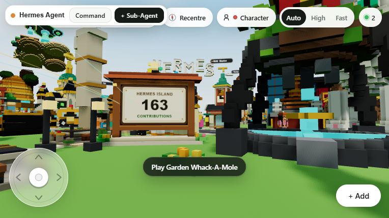
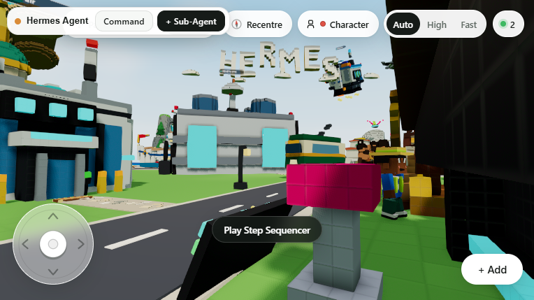

# Hermes Voxel City

<p align="center"></p>

A shared 3D voxel island where your **local Hermes agent** sculpts creations, reviews them with vision, and coordinates a live sub-agent swarm — **100% local AI, no cloud AI keys**.

Every AI call in the app (sculpting, world-weaving, critics, minigame opponents, the agent swarm) routes through the OpenAI-compatible endpoint of a locally running [Hermes agent gateway](https://hermes-agent.nousresearch.com/docs). No Google/Gemini, no external model APIs.





## What's inside

- **Voxel sculptor** — describe anything ("a cozy red mushroom cottage") and the agent returns a strict-JSON voxel blueprint: 30-60 ops, animated parts, custom palette
- **3D critic with vision** — the server renders each candidate to a 4-panel contact sheet and a vision model scores it /10 before placement
- **Living world** — 174 seeded creations (cottages, drakes, a waterfall, a datacentre), roads, roaming villagers, vehicles with physics
- **Agent swarm** — Hermes Prime + 8 island stations (architect, coder, researcher, critic...) you can dispatch tasks to and watch work
- **Interactive minigames** — tic-tac-toe, Connect Four, whack-a-mole, slot machines and more, all with an AI opponent
- **Multiplayer** — WebSocket world sync; everyone sees new creations appear live

## How a build works

`prompt → orchestrator approval → voxel JSON sculpting → vision critic review → placement → town weaver connects it with roads`

## Quick start

Prereqs: [Bun](https://bun.sh) (or Node 20+), and a local Hermes agent gateway running (default `http://127.0.0.1:8642`).

```bash
bun install

export HERMES_AGENT_TOKEN=<your gateway API_SERVER_KEY>
export HERMES_AGENT_MODEL=glm-5.3-flash          # recommended: fast + vision
export HERMES_AGENT_PROVIDER=surplus-intelligence # your provider slug

bun run dev   # serves on PORT (default 3000)
```

Open `http://localhost:3000` (or whatever PORT you set).

## Configuration

| Variable | Default | Purpose |
|---|---|---|
| `HERMES_AGENT_URL` | `http://127.0.0.1:8642` | Gateway endpoint (OpenAI-compatible `/v1/chat/completions`) |
| `HERMES_AGENT_TOKEN` | — | Gateway bearer token (the gateway's `API_SERVER_KEY`) |
| `HERMES_AGENT_MODEL` | `hermes-agent` | Model id for per-request routing |
| `HERMES_AGENT_PROVIDER` | — | Provider slug; required for the gateway to honor non-default model ids |
| `HERMES_HOME` | auto-detected | Local Hermes state dir (session/skill counts for the swarm UI) |
| `WORLD_STATE_PATH` | auto | Where the world JSON persists |

See `.env.example`.

## Notes

- **Sculpt latency is model-bound.** Heavy reasoning models can think for 10+ minutes before emitting a blueprint JSON; a fast model like `glm-5.3-flash` (with vision, for the critic) is the sweet spot. Minigames and dispatch answer in seconds.
- The client streams SSE with idle detection, disables reasoning on structured calls, and carries a strict-JSON repair loop — see `src/hermes_agent_client.ts`.
- Vision model required for full critic behavior; non-vision models fall back to text-only review.

## Stack

Vite · React · three.js · ws · tsx server (TypeScript, no database — world state is a JSON file)
